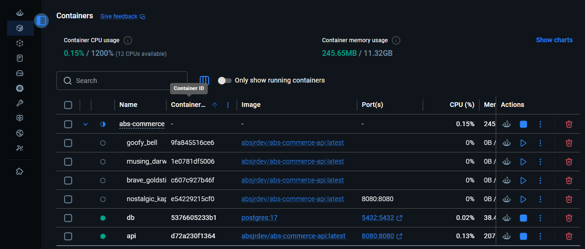
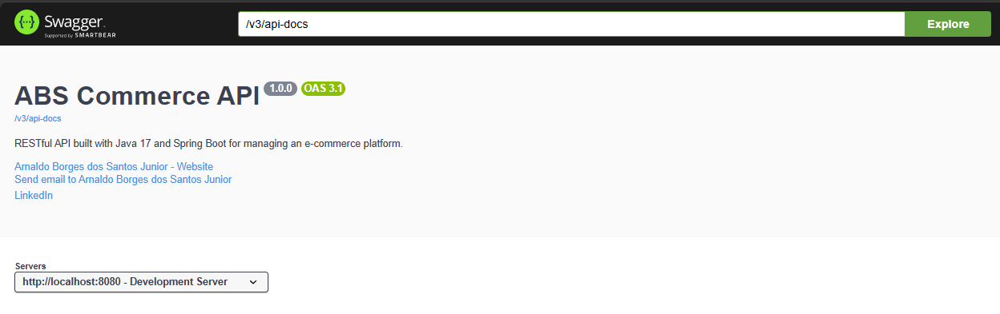
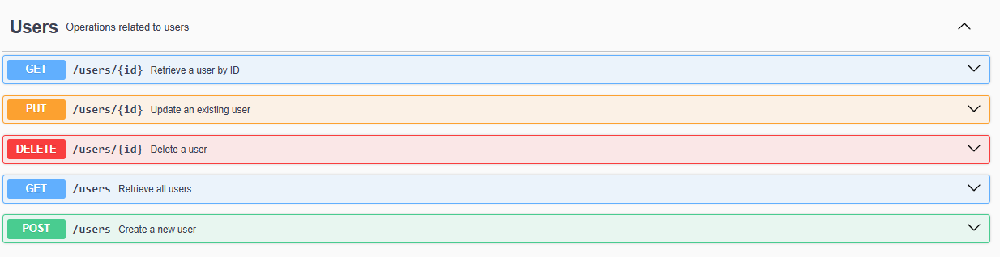
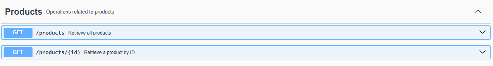
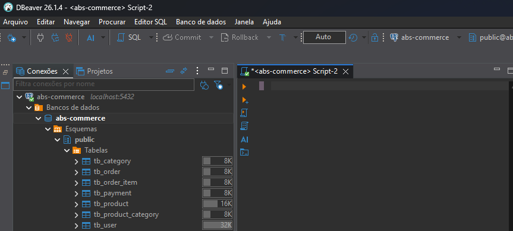

# ABS Commerce API

<p align="center">
  
  
  
  
  
  
  
  
</p>

## About the Project

**ABS Commerce API** is a RESTful backend application developed with Java and Spring Boot, designed to simulate the core operations of an e-commerce platform.

The project provides endpoints for managing users, products, categories, orders, and payments, following a layered architecture and applying object-oriented programming principles.

This project is part of my backend development portfolio, focused on building maintainable, well-structured, and scalable REST APIs.

## Features

* User management.
* Product management with category associations.
* Category management.
* Order creation and retrieval.
* Order status management with business rules.
* Simulated payment processing.
* Payment methods: PIX, debit card, and credit card.
* DTOs for API request and response data.
* Centralized exception handling.
* RESTful API architecture.
* PostgreSQL database integration.
* H2 database support for testing.
* API documentation with Swagger / OpenAPI.
* Docker support.

## Technologies

| Technology        | Purpose                         |
| ----------------- | ------------------------------- |
| Java 17           | Main programming language       |
| Spring Boot 3     | Backend framework               |
| Spring Data JPA   | Data persistence                |
| Hibernate         | ORM                             |
| Maven             | Dependency management and build |
| PostgreSQL        | Relational database             |
| H2 Database       | In-memory database for testing  |
| Swagger / OpenAPI | API documentation               |
| Docker            | Containerization                |
| JUnit 5 / Mockito | Automated testing               |

## Architecture

The application follows a layered architecture, separating responsibilities between the API, business logic, and persistence layers.

```text
Controller
    |
    v
DTO <-> Entity
    |
    v
Service
    |
    v
Repository
    |
    v
Database
```

### Layers

* **Controller:** Handles HTTP requests, receives request DTOs, converts data between DTOs and entities, and returns response DTOs.
* **Service:** Contains business logic, validations, and application rules.
* **Repository:** Handles database access using Spring Data JPA.
* **Entity:** Represents the application's domain objects and their relationships.
* **DTO:** Defines the data exposed through API requests and responses.
* **Exception:** Contains custom exceptions and centralized error handling.

## Domain Model

The application includes the following main entities:

| Entity    | Description                                             |
| --------- | ------------------------------------------------------- |
| User      | Represents users and customers                          |
| Product   | Represents products available in the store              |
| Category  | Groups products into categories                         |
| Order     | Represents customer orders                              |
| OrderItem | Represents products and quantities within an order      |
| Payment   | Represents payment information associated with an order |

### Entity Relationships

* A product can belong to multiple categories.
* A category can contain multiple products.
* An order belongs to a customer.
* An order contains one or more order items.
* Each order item references a product.
* An order can have an associated payment.

## Business Rules

### Products and Categories

* Products must be associated with at least one category.
* Categories associated with a product must exist in the database.
* Product updates must preserve valid category associations.

### Orders

Orders follow a defined status lifecycle.

| Status            | Code | Description                        |
| ----------------- | ---: | ---------------------------------- |
| `WAITING_PAYMENT` |    1 | Order created and awaiting payment |
| `PAID`            |    2 | Payment confirmed                  |
| `SHIPPED`         |    3 | Order shipped                      |
| `DELIVERED`       |    4 | Order delivered                    |
| `CANCELLED`       |    5 | Order cancelled                    |

### Order Status Transitions

```text
WAITING_PAYMENT
    |
    +----> PAID
    |        |
    |        +----> SHIPPED
    |                  |
    |                  +----> DELIVERED
    |
    +----> CANCELLED

PAID ----> CANCELLED
```

The application validates status transitions to prevent invalid state changes.

* Payment confirmation changes the order status to `PAID`.
* A paid order can be shipped.
* A shipped order can be marked as delivered.
* Orders awaiting payment can be cancelled.
* Paid orders can be cancelled according to the current business rules.
* `DELIVERED` and `CANCELLED` are terminal statuses.

### Payments

* Payments are associated with orders.
* The payment method must be valid.
* Only orders awaiting payment can be paid.
* Payment processing is simulated and does not integrate with an external payment gateway.

Supported payment methods:

| Method        | Description |
| ------------- | ----------- |
| `PIX`         | PIX payment |
| `DEBIT_CARD`  | Debit card  |
| `CREDIT_CARD` | Credit card |

## API Endpoints

The following endpoints represent the main resources currently implemented.

### Products

| Method   | Endpoint         | Description              |
| -------- | ---------------- | ------------------------ |
| `GET`    | `/products`      | Retrieve all products    |
| `GET`    | `/products/{id}` | Retrieve a product by ID |
| `POST`   | `/products`      | Create a product         |
| `PUT`    | `/products/{id}` | Update a product         |
| `DELETE` | `/products/{id}` | Delete a product         |

### Categories

| Method   | Endpoint           | Description               |
| -------- | ------------------ | ------------------------- |
| `GET`    | `/categories`      | Retrieve all categories   |
| `GET`    | `/categories/{id}` | Retrieve a category by ID |
| `POST`   | `/categories`      | Create a category         |
| `PUT`    | `/categories/{id}` | Update a category         |
| `DELETE` | `/categories/{id}` | Delete a category         |

### Orders

| Method  | Endpoint              | Description             |
| ------- | --------------------- | ----------------------- |
| `GET`   | `/orders`             | Retrieve all orders     |
| `GET`   | `/orders/{id}`        | Retrieve an order by ID |
| `POST`  | `/orders`             | Create an order         |
| `PATCH` | `/orders/{id}/status` | Update the order status |

### Payments

| Method | Endpoint                    | Description                   |
| ------ | --------------------------- | ----------------------------- |
| `POST` | `/orders/{orderId}/payment` | Create a payment for an order |

> Note: The endpoint list should be checked against the current controllers before publication.

## Request Examples

### Create a Product

`POST /products`

```json
{
  "name": "Smartphone",
  "description": "A modern smartphone",
  "price": 1999.99,
  "imgUrl": "https://example.com/smartphone.jpg",
  "categoryIds": [1, 2]
}
```

### Create an Order

`POST /orders`

```json
{
  "client": {
    "id": 1
  },
  "items": [
    {
      "product": {
        "id": 1
      },
      "quantity": 2
    }
  ]
}
```

> The exact request structure depends on the current `OrderRequestDTO` implementation.

### Update Order Status

`PATCH /orders/{id}/status`

```json
{
  "status": "SHIPPED"
}
```

### Create a Payment

`POST /orders/{orderId}/payment`

```json
{
  "paymentMethod": "PIX"
}
```

## Exception Handling

The application uses centralized exception handling to return structured error responses.

| Exception                   | HTTP Status     | Description                       |
| --------------------------- | --------------- | --------------------------------- |
| `ResourceNotFoundException` | 404 Not Found   | Requested resource does not exist |
| `BusinessException`         | 400 Bad Request | Business rule violation           |
| `DatabaseException`         | 400 Bad Request | Database-related error            |
| Invalid request body        | 400 Bad Request | Invalid JSON or request data      |

### Error Response Example

```json
{
  "timestamp": "2026-01-01T12:00:00Z",
  "status": 404,
  "error": "Not Found",
  "message": "Resource not found",
  "path": "/products/999"
}
```

## Project Structure

```text
src
└── main
    ├── java
    │   └── com.absjrdev.abscommerce
    │       ├── category
    │       │   ├── application
    │       │   ├── domain
    │       │   ├── repository
    │       │   └── resources
    │       ├── product
    │       │   ├── application
    │       │   ├── domain
    │       │   ├── repository
    │       │   └── resources
    │       ├── user
    │       ├── order
    │       ├── orderItem
    │       ├── payment
    │       ├── exception
    │       └── config
    └── resources
        └── application.properties
```

The package structure is organized by domain modules, separating application services, domain entities, repositories, and REST resources.

---

Getting Started
Prerequisites

Make sure you have the following tools installed:

Java 17 or later
Maven 3.9 or later
PostgreSQL, if using the PostgreSQL profile
Docker and Docker Compose, if running with containers

Clone the repository.

```bash
git clone https://github.com/absjrdev/abs-commerce.git

cd abs-commerce
```

---
## ⚙ Application Profiles

The application currently supports two Spring profiles.

| Profile | Purpose                 |
| ------- | ----------------------- |
| `test`  | H2 database for testing |
| `prod`  | PostgreSQL database     |

### test

Used during development.

Database:

- H2 In-Memory Database

Configuration:

```properties
spring.profiles.active=test
```
### Demo Data

When running the application using the `test` profile, the database is automatically populated with sample data.

This allows anyone to test the API immediately without manually creating entities.
---

### prod

Used for production and Docker environments.

Database:

- PostgreSQL

Configuration:

```properties
spring.profiles.active=prod
```

---

## 🐳 Running with Docker

Create your environment file.

```bash
cp .env.example .env
```

Build and start the application.

```bash
docker compose up --build
```

Application running with Docker Compose.



The API will be available at:

```
http://localhost:8080
```

Swagger UI:

```
http://localhost:8080/swagger-ui/index.html
```

---

## 💻 Running Locally

Requirements:

- Java 17
- Maven

Run:

```bash
./mvnw spring-boot:run
```

---

## 🔑 Environment Variables

Example:

```properties
POSTGRES_DB=abs-commerce

POSTGRES_USER=postgres

POSTGRES_PASSWORD=postgres

SPRING_PROFILES_ACTIVE=prod

SPRING_DATASOURCE_URL=jdbc:postgresql://postgres:5432/abs-commerce

SPRING_DATASOURCE_USERNAME=postgres

SPRING_DATASOURCE_PASSWORD=postgres
```

---

## 📖 API Documentation

The API is documented using Swagger / OpenAPI.

Access:

http://localhost:8080/swagger-ui/index.html

## Swagger UI



### User Endpoints



### Product Endpoints


---

## 🗄 Database

PostgreSQL database running inside Docker.


---

## Testing

Automated tests are part of the project's development roadmap.

The planned test coverage includes:

* Service unit tests with JUnit 5 and Mockito.
* Controller tests with MockMvc.
* Integration tests for persistence and business rules.
* Validation of order status transitions.
* Product and category association validation.
* Payment processing scenarios.
* Exception handling and invalid request scenarios.

Run the test suite using:

```bash
./mvnw test
```

## Roadmap

### Completed

* [x] Initial Spring Boot project setup.
* [x] Layered application architecture.
* [x] User, product, and category management.
* [x] Order creation and retrieval.
* [x] Order status lifecycle.
* [x] Payment method modeling.
* [x] Simulated payment processing.
* [x] DTO-based API requests and responses.
* [x] Centralized exception handling.

### In Progress

* [ ] Automated unit and integration tests.
* [ ] Additional validation and edge-case coverage.
* [ ] Final API documentation review.

### Planned

* [ ] Authentication and authorization with JWT.
* [ ] CI/CD pipeline.
* [ ] Docker image publishing.
* [ ] Cloud deployment.
* [ ] Monitoring and logging improvements.

## Future Improvements

Potential future enhancements include:

* Integration with a real payment gateway.
* Inventory management.
* Shipping and delivery management.
* Shopping cart functionality.
* Product search and filtering.
* Pagination and sorting.
* Advanced security and access control.

## 👨‍💻 Author

Developed by **Arnaldo Borges dos Santos Junior**

Backend Developer

---

## About ABS

**ABS — Application Backend Solutions**

A personal portfolio focused on building modern backend applications with Java, Spring Boot, and enterprise software engineering practices.

---

## 📄 License

This project is licensed under the MIT License and is available for learning and educational purposes.
